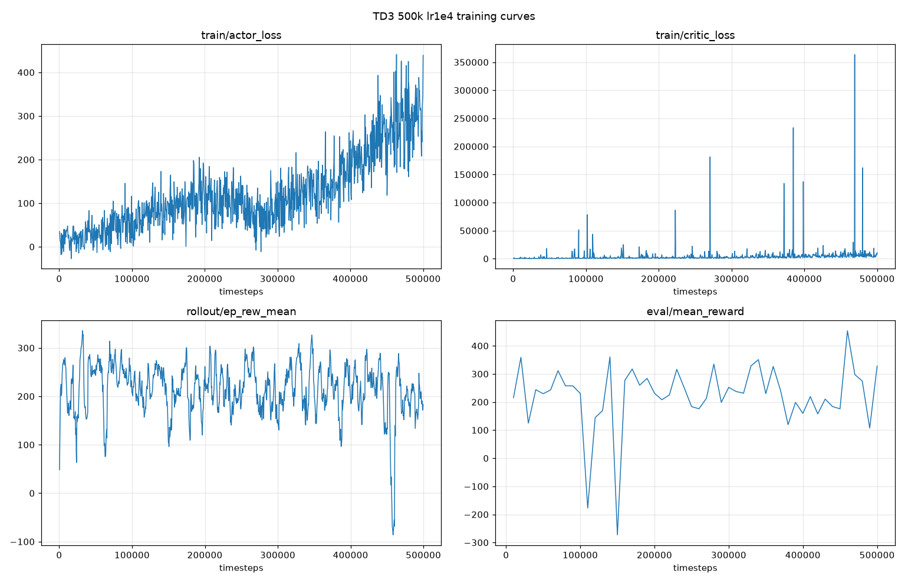
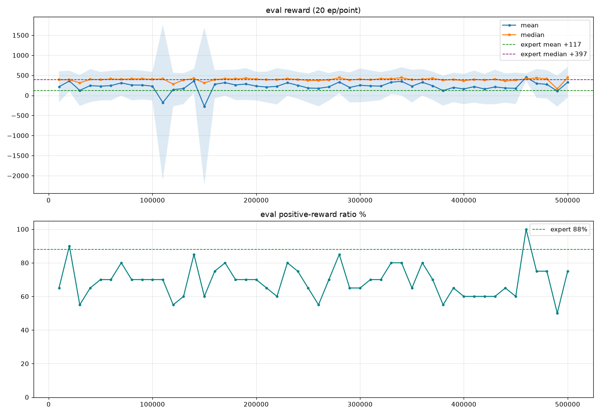

# TD3 500k lr1e4 训练分析报告

> 生成时间：2026-07-08
> 模型：`rl_td3/checkpoints/training_500k_lr1e4/`
> 评估来源：蒙特卡洛 100 轮 (`monte_carlo_eval_20260708_1852.log`) + TB 曲线 + `evaluations.npz`

## 一句话结论

**500k 训练不成功，动作 collapse 重现。** 策略塌缩成忽略状态的常数动作（γ=-3, wT=1e5, wE=1e4），只是把塌缩边界从旧的 wT=1e4 推到了新上界 wT=1e5。SESSION_SUMMARY 中"动作空间扩展已解决 collapse"的结论被推翻。

---

## 1. 动作 collapse 的直接证据（蒙特卡洛日志 46–49 行）

抽样 20 个不同初态，策略网络输出完全相同：

| 动作分量 | 均值 | 范围 | 是否塌缩边界 |
|---------|------|------|------------|
| γ  | -3.000 | [-3.000, -3.000] | 下边界 |
| wT | 1.00e+05 | [1.00e+05, 1.00e+05] | **新上边界** |
| wE | 1.00e+04 | [1.00e+04, 1.00e+04] | 上边界 |

对比旧 50k 的塌缩动作（γ=-3, wT=1e4, wE=1e4）：**同一现象，边界平移**。扩展动作空间没有根治，只把塌缩点延后了。

## 2. 蒙特卡洛真实性能（100 轮）

| 指标 | 结果 |
|------|------|
| 双防均规避成功 (d≥20m) | 81/100 = 81.0% |
| 到达目标 (zT≤25m) | 60/100 = 60.0% |
| **规避+到达 综合达标** | **49/100 = 49.0%** |
| 被拦截 (r_MD<6m) | 6/100 = 6.0% |
| 最小脱靶 D1 mean±std (m) | 1636.6 ± 1898.7 |
| 最小脱靶 D2 mean±std (m) | 1805.3 ± 1997.0 |
| 终端 ZEM mean±std (m) | 27017.4 ± **44385.4**（方差巨大→一批完全打飞） |
| 累计奖励 mean±std | 301.73 ± 386.16 |

终端 ZEM 巨大方差 → 双峰分布：大部分初态成功，约 30% 初态用同一常数动作彻底失败。

## 3. 训练曲线

关键观察：
- **actor_loss 单调上升**（~0 → 439）：与旧 50k 单调上升完全一致，是 collapse 的典型特征。50k v2 那次 263→87 下降只是因为还在早期没暴露。
- **critic_loss 发散不收敛**：基线从几百抬到 1e4，频繁尖峰到 20万~36万。Q 值长训练高估发散，给 actor 喂错误梯度。
- **rollout/ep_rew_mean 平台震荡**（150~280），无上升趋势，460k 处崩到 -85。

| 采样步数 | actor_loss | critic_loss | ep_rew_mean | ep_len_mean |
|---------|-----------|------------|------------|------------|
| 412 | 35.0 | 362.5 | 48.4 | 41.2 |
| 49,524 | 14.3 | 809 | 245.6 | 50.3 |
| 95,395 | 89.3 | 1554 | 240.8 | 48.5 |
| 139,699 | 109.3 | 609.7 | 235.8 | 50.2 |
| 184,548 | 197.7 | 1254 | 176.0 | 49.4 |
| 274,169 | 99.0 | 2552 | 176.0 | 45.2 |
| 364,031 | 115.0 | 1223 | 194.2 | 44.6 |
| 409,104 | 179.8 | 3118 | 242.2 | 52.1 |
| 458,267 | 239.1 | 2636 | -75.5 | 72.7 |
| 500,000 | **439** | **1.068e+04** | 182.6 | 44.7 |

## 4. 评估曲线

关键观察：
- **median 全程稳定贴专家中位 397**（橙线）：常数动作对"典型初态"恰好是还行的激进规避策略。
- **mean 被少数灾难 episode 拖低**：110k、150k 处 std 冲到 1900+，min 到 -8500 → 约 30% 初态用同一常数动作彻底失败。
- **正奖励比例卡在 55–85%**，全程没突破专家 88%（460k 孤点 100% 是偶然，不可作 best_model 依据）。

eval reward 采样表：

| 步数 | mean | median | std | min | max | pos% | ep_len |
|------|------|--------|-----|-----|-----|------|--------|
| 10k | 215.6 | 390.6 | 386.3 | -289.5 | 810.8 | 65 | 45.2 |
| 50k | 229.4 | 393.1 | 354.3 | -289.5 | 855.7 | 70 | 52.2 |
| 100k | 230.4 | 401.6 | 355.3 | -289.5 | 720.7 | 70 | 47.4 |
| 110k | **-177.5** | 411.2 | **1937.8** | **-8499.8** | 684.6 | 70 | 84.9 |
| 140k | 360.5 | 421.0 | 299.3 | -289.5 | 914.9 | 85 | 52.5 |
| 150k | **-272.8** | 310.8 | **1964.3** | **-8686.8** | 782.2 | 60 | 85.3 |
| 280k | 334.9 | 439.6 | 280.7 | -289.5 | 730.2 | 85 | 60.5 |
| 340k | 350.7 | 442.3 | 350.8 | -289.5 | 882.3 | 80 | 62.5 |
| 460k | 453.5 | 411.9 | 91.9 | 367.7 | 662.7 | 100 | 62.2 |
| 500k | 327.8 | 441.7 | 384.1 | -289.5 | 906.7 | 75 | 57.0 |

## 5. 根因（修正 SESSION_SUMMARY 判断）

查 `env_step.m`：reward = r_evade(log 距离) + r_target(ZEM 惩罚) + r_energy，**不显式依赖 wT/wE**，所以不是奖励偏好大 wT。真正机制是 **TD3 经典 policy collapse**：

1. Critic 在长训练下 Q 值高估发散（critic_loss 图）；
2. 确定性 Actor 贪心到"对整个初态分布平均最优"的单一常数动作，忽略状态；
3. BC buffer（bc_ratio=0.33，会退火）只在早期稀释失真，在线数据主导后拦不住塌缩；
4. 专家动作随状态变化，塌缩后 actor 是常数 → 对不匹配初态失败。

→ SESSION 第 5.2 节"Buffer 预填充已够用、不需要 BC 预训练"在 500k 尺度上不成立。

## 6. 解决办法（按优先级）

### ⭐ 首选 — 衰减式 BC 正则（TD3+BC 变体）
在 actor loss 加 `λ(t)·‖π(s) − a_expert‖²`，λ 随训练线性衰减（前 30% 大、后期趋 0）。
- 直接对症：collapse 本质是 actor 变常数、不随状态变；专家动作随状态变，持续 BC 强制状态相关性。
- SESSION 第 5.3 节排斥 TD3+BC 是因"固定 λ 锁死超越专家"——衰减 λ 两全：前期防 collapse，后期放开允许超越。DDPGfD/TD3fD 标准做法。

### ⭐ 次选 — Q-Filter TD3fD
仅当 `Q(s,a_expert) > Q(s,π(s))` 时才施加 BC 约束，自动过滤次优专家步。比固定 BC 优雅，但要动 critic 前向。

### 必做 — 稳住 critic 抑制 Q 发散
- `target_policy_noise` 0.2→0.3、`target_noise_clip` 0.5 保持，增强 target smoothing；
- `policy_delay` 3→4~5，给 critic 更多收敛时间；
- critic lr 再降到 5e-5，或对 Q 目标做软裁剪。

### 立即可做 — 早停 + 换模型选择标准
- 曲线显示 **50k–140k 是最好区间**，500k 是过度训练。别再无脑冲 500k。
- **best_model 不要按 eval mean 选**（会被 460k 孤点骗）。改按 median 或直接跑蒙特卡洛综合成功率选。
- 建议先加载 100k/140k checkpoint 跑 100 轮蒙特卡洛，很可能比 500k 最终模型强。

### 低优先 — 缓解边界塌缩
加轻微动作正则惩罚贴边界；eval 时确认动作是否随状态变化（20 初态全常数=塌缩）。

## 7. 建议下一步

1. **验证早期 checkpoint**：把 `td3_500k_lr1e4_{100000,140000}_steps.zip` 都跑 100 轮蒙特卡洛 + 20 初态动作分布，横向对比谁没 collapse。
2. **实现衰减 BC 正则**：在 `train_td3.py` 改自定义 TD3 的 `train()`，重训 150k 短程对比 collapse 是否消除。

## 8. 文件索引

| 路径 | 说明 |
|------|------|
| `rl_td3/plots/td3_500k_train_curves.png` | 训练曲线（actor/critic/rollout/eval） |
| `rl_td3/plots/td3_500k_eval_curves.png` | 评估曲线（reward mean/median + 正奖励比例） |
| `rl_td3/checkpoints/training_500k_lr1e4/_curves_train.png` | 同上训练曲线（原位置） |
| `rl_td3/checkpoints/training_500k_lr1e4/_curves_eval.png` | 同上评估曲线（原位置） |
| `rl_td3/logs（终端输出记录）/monte_carlo_eval_20260708_1852.log` | 100 轮蒙特卡洛原始日志 |
| `rl_td3/checkpoints/training_500k_lr1e4/eval_logs/evaluations.npz` | eval 数据 (50 点 × 20 ep) |
| `rl_td3/checkpoints/training_500k_lr1e4/tb_logs/TD3_1/` | TB 日志 |
